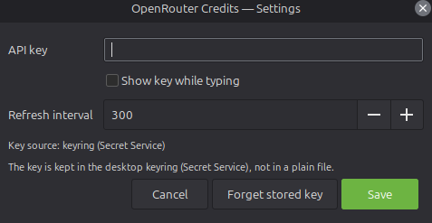

# openrouter-credits-tray

[](https://github.com/Fax/openrouter-credits-tray/actions/workflows/build.yml)

A Linux system tray indicator that shows your remaining OpenRouter credit as a
badge, so you can follow the balance without opening the dashboard.


Left-click the badge to open the menu, which includes the Settings form:



## Features

- The remaining credit is drawn inside the icon (`$3.04`). The colour is green
  above $2, amber above $0.50 and red below that.
- Refreshes every 5 minutes by default, or on demand from the menu.
- The menu shows the remaining credit, used and purchased amounts, the per-key
  budget and its reset date, the time of the last update and where the API key
  was read from.
- A Settings form to enter the API key and change the refresh interval.
- The key is stored in the desktop keyring (Secret Service: GNOME Keyring,
  KWallet). It is not written to a config file and is never shown again.
- Optional start on login, or a systemd user unit.

## Requirements

A Linux desktop with a StatusNotifier/AppIndicator tray (Cinnamon, Xfce, KDE,
GNOME with the AppIndicator extension, and others) and the system Python:

```bash
# Debian / Ubuntu / Mint
sudo apt install python3-gi gir1.2-ayatanaappindicator3-0.1 gir1.2-secret-1

# Fedora
sudo dnf install python3-gobject gobject-introspection libayatana-appindicator-gtk3 libsecret

# Arch
sudo pacman -S python-gobject libayatana-appindicator libsecret
```

`gir1.2-secret-1` is optional. Without it the keyring is not available and the
tray reads the key from `$OPENROUTER_API_KEY` or the config file instead.

## Install

### Debian, Ubuntu, Mint

Download the `.deb` from the
[releases page](https://github.com/Fax/openrouter-credits-tray/releases) and
install it with apt, which also installs the dependencies:

```bash
sudo apt install ./openrouter-credits-tray_*_all.deb
```

The package installs `/usr/bin/openrouter-credits-tray`, a man page, a menu
entry, the app icon and a system-wide autostart entry in `/etc/xdg/autostart/`, so the tray
starts for every user on login. You can also build the package yourself with
`make deb`.

### Fedora

Build the `.rpm` and install it with dnf, which also installs the dependencies:

```bash
sudo dnf install rpm-build desktop-file-utils
make rpm
sudo dnf install ./dist/openrouter-credits-tray-*.noarch.rpm
```

It installs the same files as the `.deb`. On GNOME the tray also needs the
AppIndicator extension (`gnome-shell-extension-appindicator`); KDE Plasma has a
tray built in.

### Other distributions, from source

```bash
git clone https://github.com/Fax/openrouter-credits-tray.git
cd openrouter-credits-tray
./install.sh              # copies the script to ~/.local/bin and starts it
```

The release tarball works the same way: unpack it and run `./install.sh`.

`install.sh` options:

| Option | Effect |
|---|---|
| `--autostart` | also start on login (writes `~/.config/autostart/openrouter-credits-tray.desktop`) |
| `--systemd` | install and enable a systemd user unit instead |
| `--no-start` | install only, do not start the tray |

### Adding your API key

Open the tray menu, choose Settings and paste an OpenRouter API key. You can
create one at <https://openrouter.ai/settings/keys>. When you press Save the key
is stored in your keyring.

## Usage

```bash
openrouter-credits-tray.py              # run the tray
openrouter-credits-tray.py --settings   # open the Settings form
openrouter-credits-tray.py --check      # print the key source and the current balance
openrouter-credits-tray.py --set-key    # store a key (hidden prompt, nothing in shell history)
openrouter-credits-tray.py --clear-key  # remove the stored key
openrouter-credits-tray.py --version    # print the version
```

When installed from the `.deb` or `.rpm` the command is `openrouter-credits-tray`.

Only one tray runs per user. Starting it again, for example from the app menu
while it is already in the panel, opens the Settings form instead of adding a
second icon.

The refresh interval can also be set with the `OPENROUTER_TRAY_INTERVAL`
environment variable, in seconds (default 300, minimum 30).

## Files

| Path | Contents |
|---|---|
| `~/.config/openrouter-credits/config` | settings that are not secret (refresh interval) |
| `~/.config/autostart/openrouter-credits-tray.desktop` | start on login entry, when enabled |
| `~/.local/share/icons/hicolor/*/apps/openrouter-credits-*.png` | generated badge icons |

## How the API key is handled

The key is looked up in this order: the keyring, then `$OPENROUTER_API_KEY`,
then the config file. If a plain text key is found in the config file, it is
moved into the keyring on the next start and removed from the file.

What the keyring does and does not protect against:

- It keeps the key out of plain text files, so an unencrypted disk, a backup or
  a stray file read does not expose it.
- It does not protect against other processes running as your user. While the
  keyring is unlocked, any of your processes can ask the daemon for the secret.
  Linux keyrings have no per-application access control.
- If the keyring is locked or the daemon is missing, the menu says so
  (`Key: keyring LOCKED - unlock it, or ...`) instead of silently using another
  source.

The tray only contacts `openrouter.ai/api/v1/credits` and `/api/v1/key`, over
HTTPS, with the key in an `Authorization: Bearer` header.

## Troubleshooting

### The tray icon shows a broken image

The panel finds icons by name through the GTK icon theme, which uses
`icon-theme.cache`. The app writes its badge to
`~/.local/share/icons/hicolor/<size>/apps/` and rebuilds that cache after every
write, because an outdated cache hides new icon files. If you still see a broken
image, rebuild the cache by hand:

```bash
gtk-update-icon-cache -f -t ~/.local/share/icons/hicolor
```

### The icon appears only after the next refresh

If a new icon name is announced at the same moment its file and the cache are
written, the panel can look it up before the cache is ready. The app writes the
file first and announces the name about 350 ms later, so this should not happen.

### The badge shows `n/a` and the menu shows an error

Check the `Key:` line in the menu:

- `not set`: no key was found. Open Settings and add one.
- `keyring LOCKED`: unlock your keyring. On Mint/Cinnamon the Login keyring is
  unlocked at login by PAM; a keyring with a different password stays locked.
- `HTTP 401`: the key is wrong or has been revoked.
- `Network error`: `openrouter.ai` cannot be reached.

### Nothing appears in the tray

Check that your panel has a status notifier area and that
`org.kde.StatusNotifierWatcher` is on the session bus:

```bash
gdbus call --session --dest org.kde.StatusNotifierWatcher --object-path /StatusNotifierWatcher \
  --method org.freedesktop.DBus.Properties.Get org.kde.StatusNotifierWatcher RegisteredStatusNotifierItems
```

A tray item can stay in the panel after its process has exited. On Mint,
restarting `xapp-sn-watcher` removes stale entries without restarting the shell.

### The tray does not start on login

The app can start before the panel is ready. It waits for the status notifier
watcher before creating the icon, and the autostart entry also passes
`--delay 5`.

## Uninstall

Package install:

```bash
sudo apt remove openrouter-credits-tray   # Debian, Ubuntu, Mint
sudo dnf remove openrouter-credits-tray   # Fedora
```

Source install:

```bash
make uninstall
```

Either way, your API key stays in the keyring. To remove it and the remaining
files:

```bash
openrouter-credits-tray.py --clear-key
rm -rf ~/.config/openrouter-credits
rm ~/.local/share/icons/hicolor/*/apps/openrouter-credits-*.png
```

## Building

```bash
make test        # unit tests
make deb         # dist/openrouter-credits-tray_<version>_all.deb
make dist        # dist/openrouter-credits-tray-<version>.tar.gz
make install     # install for the current user (same as ./install.sh --autostart)
make uninstall   # remove the user install (the keyring entry is kept)
make icons       # regenerate packaging/icons from the app's drawing code
make release V=patch   # publish a new version (see Releases below)
```

The version is read from `__version__` in the script, so the package, the
tarball and `--version` always match.

The `.deb` is `Architecture: all`. It depends on `python3-gi`, `gir1.2-gtk-3.0`
and `gir1.2-ayatanaappindicator3-0.1` and recommends `gir1.2-secret-1`, so
`apt install` pulls in everything it needs. It installs a system-wide autostart
entry and does not touch anything in users' home directories. Each user's API
key goes into their own keyring.

The script starts with `#!/usr/bin/python3` rather than `#!/usr/bin/env python3`
on purpose. The app needs the distribution's GI and cairo packages, and
`env python3` can pick up a venv, pyenv or conda interpreter that has neither.

### Releases

The GitHub Actions workflow in `.github/workflows/build.yml` runs on every push
and pull request. It runs the tests, builds the `.deb` and the tarball, checks
the package with lintian and test-installs it. The built files are kept as a
workflow artifact.

To publish a release, run the release script from a clean, up to date
`master`:

```bash
make release V=patch     # 1.0.0 -> 1.0.1; also minor, major, or e.g. V=1.2.0
```

It runs the tests, sets `__version__`, checks that the `.deb` builds, commits
`Release X.Y.Z`, creates the tag `vX.Y.Z` and asks before pushing. The script
can also be called directly as `./packaging/release.sh patch`, with
`--dry-run` to only show what it would do, `--no-push` to stop before pushing,
or `--yes` to push without asking.

When the tag reaches GitHub, the workflow checks that it matches
`__version__` and creates a GitHub Release with the `.deb` and the tarball
attached.

## Development

```bash
python3 -m unittest discover -s tests -v
```

The tests cover the helper functions and need no display, keyring or network.
They import the app, which needs `python3-gi`, so run them with the system
Python. The whole app is the single file `openrouter-credits-tray.py`.

## License

MIT. See [LICENSE](LICENSE).
